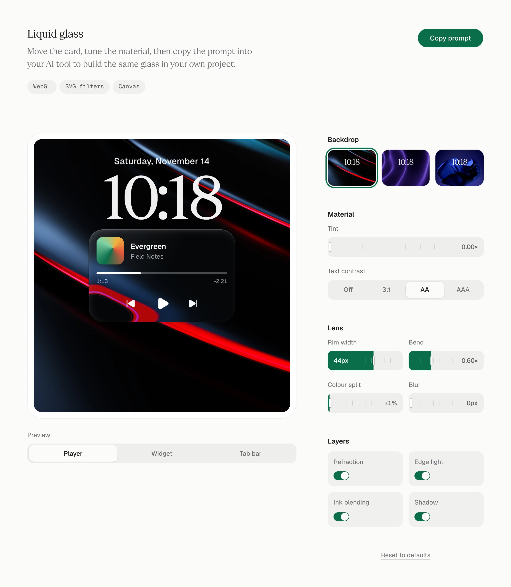

# Liquid glass

A playground for a liquid glass material on the web. Drag a glass player, widget or tab bar across a backdrop, tune the material, then copy a prompt that tells your AI coding tool how to build the same glass, with your settings, in your own project.



## What it does

- **Three previews.** A now-playing player, a weather widget and a floating tab bar. Drag them, flick them into a corner, or move them with the arrow keys.
- **Three backdrops.** Dark photos with glowing light, each with a lock-screen clock painted in, so there is real detail for the glass to bend.
- **The material, layer by layer.** Tint, a text contrast floor (off, 3:1, AA or AAA), rim width, bend, colour split and blur, plus switches for refraction, edge light, ink blending and shadow.
- **Copy prompt.** Writes your current settings into a step-by-step prompt for Claude, Cursor or any other AI coding tool.

## How the glass works

- **Edge refraction.** Chrome and Edge bend the backdrop with an SVG displacement filter. Safari and Firefox can't use SVG filters in `backdrop-filter`, so the same bend is drawn with WebGL.
- **Adaptive ink.** Each surface samples the backdrop behind it and picks dark or light text, with a dead zone so it never flickers at the threshold.
- **Contrast floor.** The tint thickens only where text would otherwise fall below the chosen WCAG ratio.
- **Accessibility settings.** Reduce Transparency makes the glass solid, Reduce Motion stops it gliding, and forced colours keep it legible.

The glass component lives in [`src/components/liquid-glass`](src/components/liquid-glass) and has its own README.

## Run it

```bash
pnpm install
pnpm dev     # http://localhost:3000
pnpm build
pnpm test    # unit tests for the glass component
```

## Stack

Next.js (App Router), Tailwind CSS v4, shadcn/ui on Base UI, Motion for springs, NumberFlow for the slider values, and Geist and Geist Serif for type.

```
src/
  app/                      page, layout and theme (globals.css)
  components/
    liquid-glass/           the glass component, self-contained
    site/card-demo.tsx      previews, settings and the copy-prompt button
    ui/                     shadcn components and the scrub slider
  hooks/use-wallpaper.ts    paints a backdrop and exposes it to the glass
  lib/wallpapers.ts         the backdrop photos and the lock-screen clock
  lib/prompt.ts             builds the prompt from the settings
```

The backdrops are painted onto a canvas so the glass can read them: that drives the text colour, the tint and, in Safari and Firefox, the refraction. The photos are served from `public/wallpapers` so the canvas stays readable.

## Browsers

Tested in Chrome and in Playwright's WebKit and Firefox builds. Not yet tested in the Safari app or on a real phone.

## Credits

Backdrop photos from Unsplash, free under the [Unsplash License](https://unsplash.com/license): [Luke Hales](https://unsplash.com/photos/abstract-dark-background-with-red-and-blue-glowing-lines-BLkm-JJ_uoU), [Mirella Callage](https://unsplash.com/photos/abstract-purple-waves-on-a-dark-background-ZQSPIiFEMoU) and [majed swan](https://unsplash.com/photos/an-abstract-blue-background-with-wavy-shapes-_PvpgpQpHqs).
